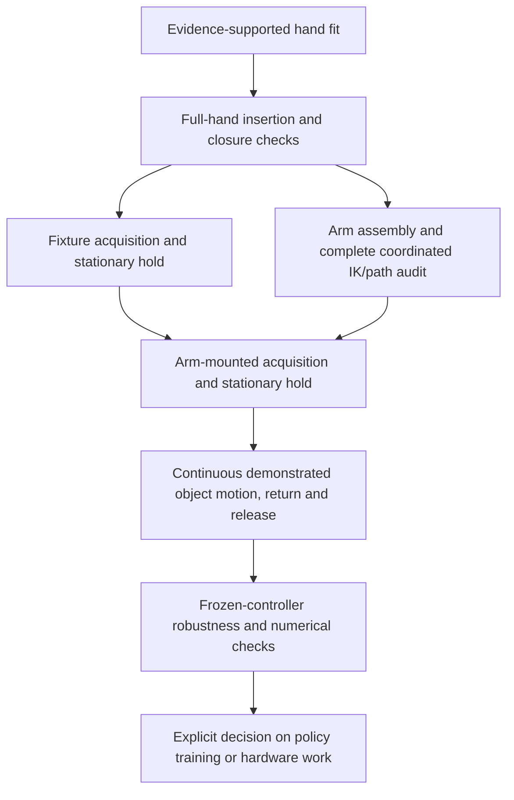

# From a fitted grasp to moving control

A stationary hold is a useful isolation test, not proof of moving manipulation.
The object remains free under gravity. Holding robot targets fixed lets us ask
whether contact geometry and the available finger control can retain the payload
without simultaneously changing its acceleration, orientation or moment arms.
A rendered contact fit answers a different question: it only establishes a
possible pose under the declared geometric assumptions.

## Two holds and two kinds of arm check

Initial hand fitting positions the embodiment's real pads and joints at proposed
contacts. Insertion checks examine the complete fingers, palm and surrounding
geometry along approach and closure. A basic endpoint reachability check can
reject unsuitable arm/base arrangements early. None establishes loaded retention.

A **fixture hold** tests articulated, torque-limited hands on Cartesian wrist
fixtures with the free object. This isolates hand/contact problems from detailed
arm dynamics. Fixtures are simplified wrist actuation with declared limits, not
actuators or constraints attached to the object. This can be run before expensive
full arm fitting. Early reachability screening is useful but is not a universal
prerequisite for this isolated diagnostic.

A **full arm-path audit** fits actual arm joints over all planned timestamps and
checks wrist FK, joint travel margins, sampled speed and collisions. Endpoint
reachability alone cannot catch an intermediate collision, wrist fold or speed
violation. This is still kinematic feasibility, not a loaded physics result.

An **arm-mounted hold** removes wrist fixtures and retains the actual arm joints,
inertia, torque-limited actuators and tracking response. The same object weight
creates joint torques; small arm deflections can change wrist-relative contact
locations and how the hands share load. A fixture pass cannot substitute for this
test. Assembly and complete path admission necessarily precede it.

The useful dependency graph is:

C and D can be ordered to control experiment cost. A fixture study may omit D
while diagnosing contact mechanics, but it cannot claim arm feasibility. A new
arm-mounted candidate requires D even if an earlier grasp had reachable arms.

## What a hold must measure

Score the complete declared acquisition and hold, with a fixed grasp-drift anchor.
Measure primary/support wrist-relative object drift, object rotation, suspended
clearance, opposed contacts, supporting load, collisions and native actuator/joint
limits. A few frames of contact or a low object tracking error is insufficient.
A failed hold should send the investigation back to seating, contact moment arms,
load sharing or tracking response, according to the evidence. It is not always
necessary to tune every failed grasp to pass: an explicitly labeled development
motion test can diagnose a failure, while remaining rejected and unpromoted.

A hold pass tests one loading condition. Moving adds translational/angular
acceleration, changing contact loads and leverage. Therefore motion and robustness
are fresh tests. A diagnostic pause must not be inserted into the final capture
trajectory to manufacture retention or pose scores. Preserve original capture
clock, reference poses, acquisition anchors and phase-specific return/release
criteria in the continuous test.

## Implemented checks and limits of orchestration

| Stage | Existing reusable implementation | Scope |
| --- | --- | --- |
| Hand/contact fitting | `bilateral_grasp`, `pad_contacts`, `bearing_support_plan` | Native joints, real collision pads; reconstructed surfaces do not certify observations |
| Insertion/closure | `pad_grasp_planning.path_audit`, `arm_finger_plan.path_screen` | Sampled complete-hand and assembled-arm checks, not continuous collision certification |
| Fixture hold | `object_grasp_pilot`, `bilateral_evaluate` | Free-object dynamics; force-control promotion pins a complete passing stationary fixture trial |
| Full arm fitting | `arm_hand_assembly`, `arm_path_audit` | Source/mount identity, FK, sampled speed, joint margin and collision checks |
| Arm-mounted hold | `arm_replay_pilot` with `stationary_hold` | Actual simulated arm response, complete acquisition and declared hold |
| Matched moving retry | `arm_finger_plan.validate_stationary`, `continuous_reference` | Relevant new replanning options require a passing matching arm hold, unchanged settings and complete clock |
| Robustness | `grasp_sensitivity`, `arm_robustness` | Pinned controllers and explicitly bounded physical perturbations |
| Readiness assessment | `r2s2r assess` / `evidence_assessment` | Aggregates explicitly pinned reported claims; does not independently certify them or start training |

The named `object-reference-control` recipe currently orchestrates only
`arm-path-audit` then `arm-replay`. It starts from an existing grasp trial.
Contact search, fixture evaluation, preparation of separate stationary/moving
configs and robustness campaigns remain explicit tool invocations. This is a
composable workflow, not a single automatic end-to-end readiness service.

The arm stationary promotion gate is enforced for demonstrated replays using a
new finger plan, seating plan, acquisition profile, unloaded-acquisition override,
or explicit `validated_stationary`. It checks result/state/scene hashes, success,
condition, controller/config equality and the complete source command duration.
Legacy/default and separately scoped development paths retain their historical
behavior. Consequently this is not a universal claim that every moving diagnostic
in repository history followed a passing hold.

An old success does not transfer automatically to new contacts, wrist orientations,
arm/base placements, physics, acquisition anchors, reference horizons or release
strategies. Preserve the old result and require fresh matched evidence. New
bearing proposals always report `control_admitted: false`; a clear side-thumb
insertion alone cannot bypass load balance, independent contact evidence, actual
arm fitting or stationary acceptance.

## Preserve state across geometric stage setup

Moving one hand's base must not reset the other hand, the free object's pose,
velocities or simulation clock. MuJoCo constant rebuilding uses its data argument
as workspace. `object_grasp_pilot.set_root_frame(..., preserve_state=True)` uses
a separate workspace, retaining live state; its default retains historical
initialization behavior for frozen-controller compatibility. The bearing planner
uses the preserving mode and asserts primary/object state before fitting.
Stage snapshots and source hashes identify which behavior produced an artifact.
A rejected preflight produced with an incorrect state transfer is superseded by
a corrected repeat, not silently relabeled as a successful controller.
