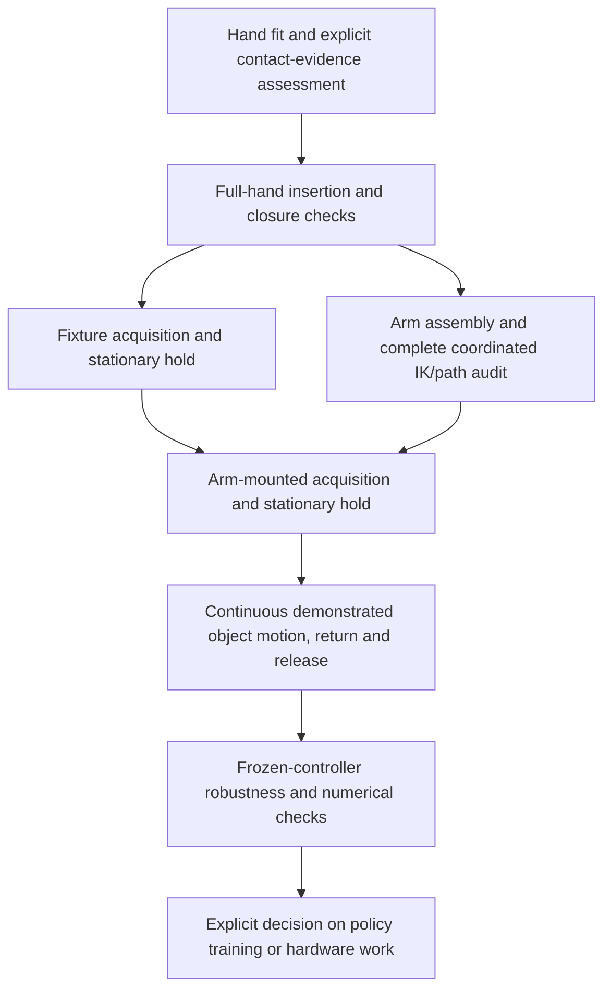

# From a fitted grasp to moving control

[Command decomposition and table load transfer](TABLE_LOAD_TRANSFER.md) separate
planned motion, corrected wrist targets and actual tracking. A bounded table-force
response shares existing wrist authority and cannot erase an earlier failed lift.

[Grasp force-and-torque auditing](GRASP_WRENCH_AUDIT.md) separates ideal
actuator-limited contact capacity from controller realization, and airborne
support from hands pushing against the table during load transfer. Saved wrist
variation and rendering effects must also be distinguished before diagnosing sway.

[Descent pad seating and load-sharing probes](DESCENT_PAD_CONTROL.md) distinguish
actual measured contact migration from lost contact and preserve the original
acquisition scoring anchor while testing targeted finger-task changes.

[Measured slip/tilt feedback](CLOSED_LOOP_GRASP_FEEDBACK.md) uses acquisition-time
anchors, coordinated object-pivot wrist corrections and bounded recovery before
release. Its zero-gain replay and complete loaded acceptance are separate checks.

[Bounded wrist/posture authority probes](BOUNDED_GRASP_CORRECTIONS.md) retain the
frozen continuous source and report loaded motion and paired stationary evidence
without replacing an earlier baseline or issuing a promotion certificate.

A stationary hold is a useful isolation test, not proof of moving manipulation.
The object remains free under gravity. Holding robot targets fixed lets us ask
whether contact geometry and the available finger control can retain the payload
without simultaneously changing its acceleration, orientation or moment arms.
A rendered contact fit answers a different question: it only establishes a
possible pose under the declared geometric assumptions.

Keep stationary acquisition diagnostics and full motion/return/release results
under distinct, pinned identities. Better mean object-pose tracking does not erase
failed retention or clearance gates. See [continuous tracking proxies and the
phase-aware residual-learning boundary](CONTINUOUS_TRACKING_PROXY.md).

For an explicitly requested full-motion diagnostic before a stationary pass,
`diagnostic_stationary: {result, sha256}` pins the complete stationary arm trial.
The runner permits only the motion-condition/output/purpose change, retains full
path/collision checks, and appends `diagnostic_motion_without_stationary_promotion`.
This cannot produce a passing task result or substitute for `validated_stationary`.
Incomplete holds and residual-on-residual promotion remain rejected.

`arm_motion_review --config ...` builds a synchronized browser comparison from two
pinned full-motion result/review receipts. Config contains two `runs` entries,
each with `label` and `result: {path, sha256}`, plus a fresh `output`. Native frame
IDs, duration and recorded phase/timestamp samples must match. Different audited
grasps/paths are explicitly labelled as a visual comparison, not a controlled
single-variable experiment. Existing state/video artifacts remain unchanged.

## Two holds and two kinds of arm check

Initial hand fitting positions the embodiment's real pads and joints at proposed
contacts. Insertion checks examine the complete fingers, palm and surrounding
geometry along approach and closure. A basic endpoint reachability check can
reject unsuitable arm/base arrangements early. None establishes loaded retention.

A **fixture hold** tests articulated, torque-limited hands on Cartesian wrist
fixtures with the free object. This isolates hand/contact problems from detailed
arm dynamics. Fixtures are simplified wrist actuation with declared limits, not
actuators or constraints attached to the object. This can be run before expensive
full arm fitting. Early reachability screening is useful but is not a universal
prerequisite for this isolated diagnostic.

A **full arm-path audit** fits actual arm joints over all planned timestamps and
checks wrist FK, joint travel margins, sampled speed and collisions. Endpoint
reachability alone cannot catch an intermediate collision, wrist fold or speed
violation. This is still kinematic feasibility, not a loaded physics result.

An **arm-mounted hold** removes wrist fixtures and retains the actual arm joints,
inertia, torque-limited actuators and tracking response. The same object weight
creates joint torques; small arm deflections can change wrist-relative contact
locations and how the hands share load. A fixture pass cannot substitute for this
test. Assembly and complete path admission necessarily precede it.

The useful dependency graph is:

C and D can be ordered to control experiment cost. A fixture study may omit D
while diagnosing contact mechanics, but it cannot claim arm feasibility. A new
arm-mounted candidate requires D even if an earlier grasp had reachable arms.

Evidence assessment must distinguish observed agreement, observed disagreement
and unavailable visibility. Hidden contacts do not become verified because a
mesh is watertight or a simulated hold passes. They also do not automatically
prohibit a bounded, explicitly hypothesis-based simulator diagnostic. Such a
diagnostic cannot establish physical geometry or hardware readiness. Preserve
the uncertainty and test sensitivity before drawing broader conclusions.

## What a hold must measure

Score the complete declared acquisition and hold, with a fixed grasp-drift anchor.
Measure primary/support wrist-relative object drift, object rotation, suspended
clearance, opposed contacts, supporting load, collisions and native actuator/joint
limits. A few frames of contact or a low object tracking error is insufficient.
A failed hold should send the investigation back to seating, contact moment arms,
load sharing or tracking response, according to the evidence. It is not always
necessary to tune every failed grasp to pass: an explicitly labeled development
motion test can diagnose a failure, while remaining rejected and unpromoted.

A hold pass tests one loading condition. Moving adds translational/angular
acceleration, changing contact loads and leverage. Therefore motion and robustness
are fresh tests. A diagnostic pause must not be inserted into the final capture
trajectory to manufacture retention or pose scores. Preserve original capture
clock, reference poses, acquisition anchors and phase-specific return/release
criteria in the continuous test.

## Implemented checks and limits of orchestration

| Stage | Existing reusable implementation | Scope |
| --- | --- | --- |
| Hand/contact fitting | `bilateral_grasp`, `pad_contacts`, `bearing_support_plan` | Native joints, real collision pads; reconstructed surfaces do not certify observations |
| Insertion/closure | `pad_grasp_planning.path_audit`, `arm_finger_plan.path_screen` | Sampled complete-hand and assembled-arm checks, not continuous collision certification |
| Replacement support acquisition | `paired_acquisition_audit` | Pinned retained primary plus replacement support, both moving; native ownership, setup-state preservation, paired path and finite-patch balance |
| Saved contact evidence | `paired_contact_review` | Calibrated RGB/mask/depth and mesh self-occlusion review; contact centres, not independent finite-patch validation |
| Fixture hold | `object_grasp_pilot`, `bilateral_evaluate` | Free-object dynamics; force-control promotion pins a complete passing stationary fixture trial |
| Full arm fitting | `arm_hand_assembly`, `arm_path_audit` | Source/mount identity, FK, sampled speed, joint margin and collision checks |
| Arm-mounted hold | `arm_replay_pilot` with `stationary_hold` | Actual simulated arm response, complete acquisition and declared hold |
| Matched moving retry | `arm_finger_plan.validate_stationary`, `continuous_reference` | Relevant new replanning options require a passing matching arm hold, unchanged settings and complete clock |
| Robustness | `grasp_sensitivity`, `arm_robustness` | Pinned controllers and explicitly bounded physical perturbations |
| Readiness assessment | `r2s2r assess` / `evidence_assessment` | Aggregates explicitly pinned reported claims; does not independently certify them or start training |

The named `object-reference-control` recipe currently orchestrates only
`arm-path-audit` then `arm-replay`. It starts from an existing grasp trial.
Contact search, fixture evaluation, preparation of separate stationary/moving
configs and robustness campaigns remain explicit tool invocations. This is a
composable workflow, not a single automatic end-to-end readiness service.

The arm stationary promotion gate is enforced for demonstrated replays using a
new finger plan, seating plan, acquisition profile, unloaded-acquisition override,
or explicit `validated_stationary`. It checks result/state/scene hashes, success,
condition, controller/config equality and the complete source command duration.
Legacy/default and separately scoped development paths retain their historical
behavior. Consequently this is not a universal claim that every moving diagnostic
in repository history followed a passing hold.

An old success does not transfer automatically to new contacts, wrist orientations,
arm/base placements, physics, acquisition anchors, reference horizons or release
strategies. Preserve the old result and require fresh matched evidence. New
bearing proposals always report `control_admitted: false`; a clear side-thumb
insertion alone cannot bypass load balance, independent contact evidence, actual
arm fitting or stationary acceptance.

## Preserve state across geometric stage setup

Moving one hand's base must not reset the other hand, the free object's pose,
velocities or simulation clock. MuJoCo constant rebuilding uses its data argument
as workspace. `object_grasp_pilot.set_root_frame(..., preserve_state=True)` uses
a separate workspace, retaining live state; its default retains historical
initialization behavior for frozen-controller compatibility. The bearing planner
uses the preserving mode and asserts primary/object state before fitting.
Stage snapshots and source hashes identify which behavior produced an artifact.
A rejected preflight produced with an incorrect state transfer is superseded by
a corrected repeat, not silently relabeled as a successful controller.

## Avoid losing or misapplying earlier progress

Keep a scoped evidence ledger containing result and state hashes, contact plan,
embodiment, acquisition clock, retention anchor, physics/controller periods and
reference horizon. Preserve partial successes explicitly: a release pass remains
a release pass even if retention fails; a passing short motion is not a passing
full episode. Changing the protocol does not retrospectively invalidate a result
under its original protocol, but does require a new matched test.

Before a replacement support proceeds, test both hands moving together. A clear
support path against an already closed primary can miss a collision during
simultaneous approach. `paired_acquisition_audit` checks the native joint-linear
pregrasp/open/closed path without refitting either hand or changing the object.
It does not certify a different thumb-first schedule, actuator tracking or a
continuous collision-free path. Any later rebasing or timing-dependent finger
schedule needs its own actual command-path check.

After that check, a new fixture hold is a targeted comparison for the changed
contacts, not a restart of all prior experiments. Bind the admitted geometry to
the intended acquisition commands and retain declared drift anchors, duration,
physical assumptions and limits. A legacy staged fixture test must not silently
stand in for continuous capture timing. Perform fresh arm-path admission and an
arm-mounted hold before promoting the new grasp to continuous motion. Keep the
final reference free of diagnostic pauses and revalidate return/release when
contacts or wrist orientation change. Do not repeat an entire old robustness
matrix until the new nominal candidate merits it.

## Staged debugging and continuous task validation

Staged acquisition/lift/hold is usually the cheaper diagnostic: it separates
closure, loading and retention, and a smooth lift can reduce wrist tracking
transients. It is not inherently a weaker experiment if drift is still anchored
at acquisition completion and the complete hold is measured. Report any
hold-only drift separately; resetting the anchor at the start of the hold can
hide early slip. Differences in lift height, orientation, duration and clock
also prevent treating staged and continuous results as a one-variable comparison.

`fixture_hold` binds a pinned paired acquisition hypothesis to either a declared
7 cm, 2 s staged lift or the retained continuous object-command prefix, frozen
at its first suspended sample. Both conditions retain the native finger-pressure
settings, force limits, free object and separate physics/feedback clocks. It
checks the actual acquisition command path, native lift-command joint limits,
and the full physical hold with the shared retention/load/collision criteria.
The new fixture abstraction has position-controlled wrists; it does not replay
an older arm controller or inherit its wrist/clearance feedback success.

An optional bounded acquisition blend holds robot targets at the initial object
pose through closure, then rejoins the native-time object commands. This changes
robot commands only; it must not retime the source reference. The joined path
needs fresh admission. A prefix-hold result cannot validate the remainder of
the demonstration, table return or release.

`fixture_hold_diagnostics` compares saved actual wrist FK against nominal fixture
commands, separating tracking error from object-relative grasp drift. All
object pose errors it reports are relative to the declared diagnostic goal,
not full-demonstration accuracy scores. `fixture_hold_review` renders saved
states on CPU with explicit fixture and intentional-pause labels and portable
video playback. These tools never automatically promote an arm or moving trial.
