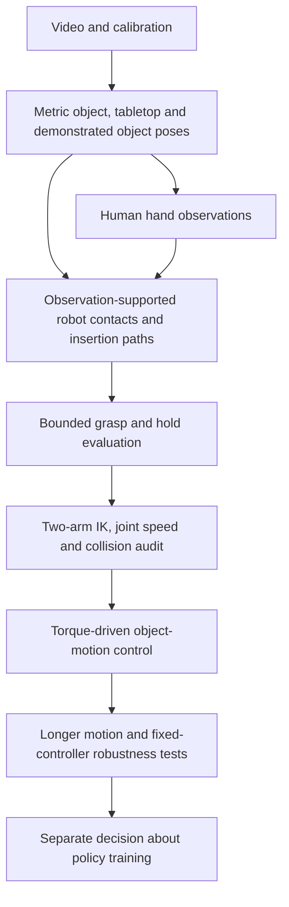

# Composable reconstruction and control pipelines

Use `r2s2r pipelines` to list named recipes. A recipe selects stages; it does not
certify a reconstruction, grasp, controller or policy. Existing configurations
with an explicit `stages` list still work, and `--stages` can select a compatible
subchain. Each stage checks its input artifact kind and content hashes and can
use its own Python environment, deadline and resource guard.

| Recipe | Starting artifact | Purpose / final artifact |
| --- | --- | --- |
| `human-reference` | Video | Reconstruction → repair → robot retargeting → correction-policy training |
| `egocentric-interaction` | `calibrated-capture` | Object reconstruction → metric hand observations for review |
| `object-reference-control` | `grasp-trial` | Arm path audit → torque-driven physics → `object-control-evaluation` |

The egocentric descriptors require the optional egocentric module to be installed.
The core can list recipes and plan object control without importing MuJoCo or
model backends. Execution needs the selected modules and their local assets.

## Object-reference workflow



Human hands supply optional timing, contact-region and grasp-strategy cues. The
robot plans contacts and chooses feasible wrist postures for its own embodiment.
The demonstrated **object** motion remains the tracking target. Accurate human
finger imitation is a separate pipeline choice, not a prerequisite for this one.

Preparation is intentionally explicit. Use `egocentric.object_task` to export the
metric scene and sufficient reference frames; then the existing
[grasp planning](OBJECT_CENTRIC_GRASPS.md), [pad planning](PAD_CONTACT_PLANNING.md)
and [guided motion](GUIDED_MOTION.md) tools to obtain an admitted grasp trial.
Geometry support, insertion clearance and force-bearing contact cannot be inferred
from human task success. A rejected contact hypothesis remains diagnostic evidence.

The named control recipe starts **after** those preparation steps. It does not
turn arbitrary video into an accepted grasp automatically. Adopt saved evidence
without changing the original experiment:

```bash
r2s2r adopt --kind grasp-trial --source /data/grasp/trial --output /data/artifacts/grasp
r2s2r plan --config examples/object-reference-control.json
r2s2r run --config /data/config/control-pipeline.json
```

The example is a template: supply the grasp artifact, local runtime, and two
existing module configurations. Set each `config_sha256` to the actual SHA-256
of its configuration file. Paths *inside* those module configurations follow
the existing module contract; use absolute asset paths. The adapter resolves
the configuration-file path relative to the pipeline configuration.

`arm-path-audit` requires an accepted grasp and matching archived states. It
binds the upstream trial into the audit configuration and pins its hash.
`arm-replay` binds the resulting audit, requires the selected complete two-arm
path to pass, then runs the existing bounded physics evaluator. Failed audits
are published for inspection; they prevent the replay stage from starting.
A completed replay can publish a **rejected** evaluation. Check
`artifact.json` metadata and `result.json`; process completion is not task success.
Neither artifact automatically starts policy training.

An existing audit can also be adopted with `--kind arm-path-audit`; select
`stages: ["arm-replay"]` and `input_kind: "arm-path-audit"`. Adoption copies
reports, scenes and state archives, retaining external asset references and
hashes. It is an evidence envelope, not a self-contained robot asset bundle.
Original inputs and rejected outputs remain intact.

## Extend motion without redefining success

`guided_motion.select_interval` requires every requested inclusive frame ID;
requesting a longer interval from a truncated export fails. Capture timestamps
and metric poses are preserved. No temporal realignment, motion rescaling or
silent gap filling is performed.

`arm_path_audit.reference_extension` accepts a hash-pinned longer reference and
explicit motion bounds. `reference_extension.reference_transforms` verifies the
entire old prefix, retains the original grasp anchor and sample clock, and
transforms both wrist targets by the same object-pose increment. Relative grasp
geometry and archived robot finger commands stay fixed. The saved command clock
must cover the new motion plus at least one second of final hold.

The transformed old object poses are **kinematic planning proxies** for collision
checks and optional feedback references. They are not new measured or simulated
object observations. Physics starts again from the original initialized free
object and uses only robot actuators. Evaluation compares actual new states to
the independently fixed object target. Only the declared motion-planning envelope
may expand; collision, contact and trajectory acceptance thresholds remain fixed.

A longer path requires fresh arm IK, speed and collision screening even when the
controller previously passed. Cartesian fixture limits do not establish arm
reachability. Nonneighbor self-collisions must not be masked to pass an extension.
The fixture-based `reference_extension` CLI remains available for a separately
labelled grasp-generation experiment; its output is not an arm-control result.

## Keep robustness separate from tuning

`arm_robustness.validate_case` pins a passing controller result and its states.
A robustness case may change only output/deadline and the explicitly declared
physical perturbation. Controller gains, reference audit, torque budgets,
timestep and other settings must match the frozen result. Supported cases are:

- Object mass/inertia scale, between 0.5 and 2.
- Sliding friction on all contact surfaces, between 0.2 and 1.2, or unchanged.
- One initial horizontal object offset, bounded by 5 mm; no vertical relocation.

These limits bound the experiment, not a validated operating range. One-at-a-time
cases do not establish robustness to combinations, sensor errors, latency,
mount errors, arbitrary position offsets or an entire episode. Preserve every
case, including failures. The comparison report names differing physical cases.

`apply_case` preserves initialized robot state across MuJoCo constant rebuilding.
The replay reuses `simulation_health` to reject solver warnings and clock resets;
finite state after MuJoCo's automatic reset is not valid continuation evidence.

For an explicit cohort, `r2s2r assess --config assessment.json` checks named Boolean
claims from hash-pinned JSON reports. Each check declares `name`, `report`,
`sha256`, a top-level `field`, and optionally `on_failure`; the configuration also
declares `scope` and a new output JSON path. False claims fail and missing claims
remain unresolved. An empty cohort, changed evidence or a non-Boolean claim is
rejected. The result aggregates reported evidence; it does not independently
validate reports or automatically approve training or hardware.

## Scores and next decisions

Track actual object pose, contact retention, wrist-frame slip, arm constraints and
completion separately. Local MPPE and ADD AUC compare simulated object motion
with the reconstructed, grasp-aligned reference; they are not finger scores or
official challenge scores. A new horizon defines a different scoring cohort.
A low trajectory error cannot compensate for lost contact or an arm collision.

A passing short nominal rollout is a retained baseline. Longer-path rejection
calls for collision-aware arm/posture planning. Mass or friction failures call
for contact/force-sharing investigation against the frozen controller. Missing
bearing geometry calls for better observations or measurements. Substantial
policy training follows an explicit complete acceptance decision for its intended
scope; it is not a way to conceal failures in the physical scene or command path.

The object-reference-control route also supports an optional simultaneous
bilateral grasp search before arm-path admission. See [bilateral body/rim
grasps](BILATERAL_GRASPS.md). It verifies both complete hand paths, finite pad
patches and shared-force budgets, then closes both hands before lifting. A
stationary diagnostic is kept distinct from demonstrated-motion success. New
planning or partial-lift success does not automatically start arm dynamics or
policy training.

The bilateral route can add [pad-force feedback](CONTACT_FORCE_FEEDBACK.md).
Moving-reference tests pin a complete passing stationary result, unchanged control
settings and the original fidelity limits. Lift-offset ownership is explicit so
clearance regulation does not silently override the demonstrated center trajectory.
Optional common object-pose feedback rotates/translates the wrist pair about the
independent goal without changing their commanded relative frames. Its world-pose
accuracy and both wrist-frame grasp-drift checks remain separate: improving one
can worsen the other. A nominal fixture pass must precede arm revalidation.
