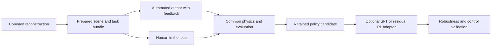

# Agentic policy campaigns

One campaign engine supports automated proposal/feedback revisions, generated
proposals reviewed by a person, and fully manual policy development. All routes
use the same scene, tools, evaluator, archive and policy export format.



The default objective is complete nominal task execution first. Successful
nominal policies remain archived when later revisions fail. A configured
robustness matrix runs only for candidates that complete the nominal task.
Further proposals target robustness and separately declared SFT, RL or control
criteria. No automatic training, policy promotion or hardware execution occurs.
Conditional reconstruction remains conditional throughout.

An existing successful manual controller can also seed a reviewed refinement
campaign. The [reference refinement backend](../../docs/REFERENCE_REFINEMENT.md)
accepts validated pressure/posture profiles around its retained path and release
logic. Verify exact empty-edit replay first, keep the successful seed as a
fallback, and configure automatic continuation or human outcome review explicitly. This is a
separate experimental condition from a from-scratch author.

## Installation

Build the root, agentic-policy, controller-actor-training and retargeting wheels
from the same revision, then install from their wheel directory:

```bash
python -m pip install --find-links /path/to/wheels 'real2sim2real[agentic,mujoco]==0.1.0'
```

Until these wheels are published, the local wheel directory is required. No
sibling ASL, GaP, RoboSimStudio, open-robot-skills or Do-as-I-do checkout is used.
Python 3.11/3.12 and Linux `bubblewrap` (`bwrap`) are required for isolated
execution. Simulation uses ordinary numerical packages and optional MuJoCo.
Reconstruction and residual RL remain separately installed modules. The tested
numerical versions are recorded by the clean-install acceptance process; pin
those when comparing saved trajectories.

## Portable experiment bundle

Supply `experiment.json`, an explicit `author/` input directory, and any
simulator configuration/assets. The continuous backend takes a relative
`runtime.json` referring to relative scene/initial-state paths. Use
`scene_bundle.portable_scene` for a flattened MJCF; nested includes are rejected
rather than silently omitted. Verify compiled model parity after relocation.

```json
{
  "mode": "manual",
  "instruction": "Acquire, carry, place, release and return home.",
  "feedback_revisions": 6,
  "rollout_timeout_s": 300,
  "backend": {"kind": "continuous", "runtime": "runtime.json"},
  "evaluation": {"target": "nominal"}
}
```

The runtime must declare physical task and home limits. The existing continuous
robot tools supply scratch IK/pad fitting, observations, joint execution,
pressure and supported release. See [continuous tools](../../docs/CONTINUOUS_POLICY_TOOLS.md).
The bundled [higher-level skill catalogue and adaptations](SKILLS.md) add
grasp fitting/acquisition, measured-offset transport, loaded-hold diagnostics
and supported placement/release. These are available through the same GaP RPC.

```bash
r2s2r agentic init --bundle /data/task --output /data/campaign
r2s2r agentic status --campaign /data/campaign
r2s2r agentic submit --campaign /data/campaign --candidate /data/my-policy
r2s2r agentic export --campaign /data/campaign --proposal P0 --output /data/selected-policy
```

A candidate contains GaP v3 `workflow.json` and optional Python scripts. Scripts
can import `NodeContext` from `real2sim2real.agentic_policy.api`. Bundled geometry
and installed real2sim2real source are available to them. Heavy geometry helpers
need the module's optional `geometry` dependencies. Franka-specific assumptions
in upstream helpers must not be applied to other embodiments without adaptation.

## Automated and reviewed authors

Set `mode` to `automatic` or `review` and configure `author.argv` as an explicit
argument list for an installed author command. It runs in a fresh isolated
workspace containing `INSTRUCTIONS.md`, tool schemas, author inputs, the previous
proposal, cumulative measured history and `feedback.json`. It must write
`candidate/workflow.json` and any scripts, or an explicit retain-baseline
`candidate/decision.json`, then exit successfully. Retain-baseline and duplicate
edit decisions stop redundant trials; bounded candidates may fail, while
promotion requires preserving the declared successes. `{workspace}` expands to that directory.
`CODE_ACCESS.json` lists all installed real2sim2real Python source and component
versions. The author can read/search those files and reuse their algorithms;
it is not restricted to the original nine robot RPC wrappers. `tools.json`
includes the robot tools, seven adapted manipulation operations, a skill
description tool, all 22 bundled geometry tools and enabled tool extensions.
`skills.json` separately lists all 33 upstream higher-level skill definitions,
their scripts/references and missing connector requirements. They are readable
source references, not automatically executable upstream workflows. Adapted
operations are executable only when the selected backend registers them;
the diagnostic-counter backend does not advertise robot adaptations as usable.
The wheel also contains `resources/project-source.zip` and its per-file hash
index: source/configuration/documentation for the other real2sim2real modules,
including reconstruction and training. The author can inspect or extract these
into its scratch workspace without installing their heavy dependencies. These
resources are generated at build time from this project, not fetched at runtime.
The graph worker registers the same library tools advertised to the author.
Missing optional dependencies or model weights remain explicit requirements.
The command can use an installed model client; authentication and model selection
belong to that provider. This module does not supply a model or account.

`author.timeout_s` bounds a call. `author.network` defaults false; enable it
explicitly for a remote provider. `author.env_keys` forwards only named environment
variables. `author.readonly` mounts additional explicitly authorized files or
provider binaries; do not mount evaluator results, reference data or entire home
folders. No provider call occurs during initialization or status inspection.

```bash
r2s2r agentic advance --campaign /data/campaign
```

Automatic mode continues through P0–P6. Review mode prepares one proposal and
returns its directory without running physics; inspect/edit it and use `submit`
to authorize that version. Manual mode never invokes an author. All modes use the
same proposal cap. Model execution errors are recorded separately from proposals.
Interrupted rollouts require explicit `retry` of the same archived candidate;
the retry is recorded and does not generate an uncounted new proposal.

## Nominal completion, robustness and admission

Transport execution can opt into contact-aware screening and bounded loaded
forecasts while preserving the original default interface. See
[simulation stability and transport validation](../../docs/SIMULATION_STABILITY.md).
An intended pad contact never excuses an obstacle or proximal-link collision;
forecast physics remains independent of the live episode and is reported.

Freeze the complete evaluation protocol before a campaign. Each candidate runs
nominal first; nominal failure cannot be replaced by good aggregate scores.
`evaluation.robustness_cases` is an optional list of unique `{name, backend}`
entries, each pointing to its own prepared runtime in the same bundle. Every
case is a fresh identified rollout, counted in the result. Missing cases do not
count as robustness success. A finite matrix reports those cases only, not an
unseen-scenario probability.

For `evaluation.target` of `sft`, `rl` or `control`, supply the corresponding
`evaluation.admission` entry with explicit `limits` and `require_robustness`.
Limits map numeric verdict paths to `min`/`max` bounds. For example,
`"peak_penetration_m": {"max": 0.003}` describes a metric, not a recommended
universal threshold. Absent/nonfinite metrics reject a gate. SFT and RL criteria
can differ from control criteria; none are inferred from task completion.
The current backend exports placement, home and peak penetration evidence;
additional acceptance metrics must be supplied by an installed evaluator adapter,
not invented by the author.

Both authoring routes export `controller-policy-candidate` artifacts containing
policy files, the prepared experiment and measured evaluation. This is the common
handoff to downstream training. An embodiment-specific SFT/RL adapter and its
zero-correction/replay checks remain necessary. Export does not automatically
make an arbitrary graph trainable or suitable for hardware.

## Isolation, provenance and scope

The graph runs in a separate filesystem/process sandbox with no network. Live
physics stays in the trusted parent and is accessed over serialized tools. The
worker cannot read the evaluator's scene files or directly access its MuJoCo
objects. Models, gains and acceptance criteria are not author commands. Graph
success is distinct from physical success. Failures never silently fall back to
unsandboxed execution. Candidate scripts and author commands have finite wall
budgets; the sandbox is Linux-specific.

`_vendor/provenance.json` pins GaP runtime/core, geometry source and upstream ASL
prompt references by revision and file hashes. Namespace relocation prevents
collisions with optional external installations. This is an ASL-derived campaign
implementation: its portable host, manual/review modes, budget and admission logic
are ours; it is not the unchanged upstream RoboSimStudio benchmark. The upstream
ASL prompts are retained as references; the task-specific brief does not assert
unconfigured randomization or held-out tests.
`_vendor/robot_skills/manifest.json` separately pins the complete higher-level
skill library. Those resources are verbatim Git objects, including the upstream
LICENSE; they retain their original imports. They are not imported or registered
as installed upstream packages. The module's own adaptations use our continuous
simulator and do not require neighboring checkouts, CuRobo or learned perception.

Optional backend integrations register an installed entry point in
`real2sim2real.agentic_backends`. Only the trusted experiment selects one.
Installed tool providers register a `register(registry)` callable through
`real2sim2real.agentic_tools`; enable their names in `tool_extensions` in the
experiment. These library extensions run in the isolated worker and cannot add
new robot/simulator command names. They have the same filesystem/network limits
as candidate code. Robot embodiments and simulator commands belong to the trusted
backend adapter. All bundled geometry tools are enabled by default.
No upstream simulator/plugin is discovered or installed automatically.

## Validation

`tools/clean_acceptance.py` runs against installed wheels in a filesystem where
workspace checkouts are absent. It tests seven automated fixture proposals,
manual verdict parity, the review gate, immutable inputs and no duplicate runs
on resume. Its deterministic author is a test fixture, not an LLM performance
claim. Separate MuJoCo acceptance compares compiled scenes and saved dynamics.
No external ASL author or training run is launched by these tests.
For a retained successful manual controller, the comparison-only
`frozen_reference` backend and `tools/manual_replay_acceptance.py` preserve
live pressure/release/home feedback and compare fresh physics against archived
states afterward. This is separate from the interface negative control;
see [standalone manual replay](../../docs/FROZEN_REFERENCE_REPLAY.md).
`tools/skill_acceptance.py` additionally exercises all seven adapted operations
through an isolated graph against a portable robot scene. Its initial-posture
negative control must reject grasp/placement success; it is not a task solution.
## External-author configuration

See [freezing author campaigns](../../docs/AUTHOR_CAMPAIGNS.md) for packet preview,
explicit external authorization, shared rollout diagnostics, perturbation cases
and separate SFT/RL/control prerequisites.


Measured proposal history, explicit retain-baseline decisions and duplicate-edit
stops are described in [author-loop controls](../../docs/AGENTIC_AUTHOR_LOOP.md).
The opt-in [contact-conditioned reference adapter](../../docs/CONTACT_REFERENCE_REFINEMENT.md)
adds bounded contact-loss posture rules while preserving the host reference and
release logic. Nonzero adaptive performance requires separate evaluation.
